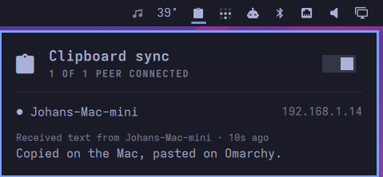

# lan-clip

The clipboard [lan-mouse](https://github.com/feschber/lan-mouse) is missing.

lan-mouse shares one mouse and keyboard between your machines, but not the
clipboard ([#105](https://github.com/feschber/lan-mouse/issues/105)).
lan-clip adds it: copy on one machine, move the pointer over, and paste.

- **Text, rich text (HTML) and images**, both ways. On macOS, TIFF and JPEG
  images (screenshots, photos) are converted to PNG for Linux apps.
- **iPhone included, through the Mac.** Anything that reaches the Mac through
  Apple's Universal Clipboard is passed on to your Linux machines.
- **No setup.** lan-clip reads lan-mouse's config: it talks to the machines
  lan-mouse talks to and trusts exactly the certificates lan-mouse trusts.
  Traffic is mutual TLS, pinned to those fingerprints.
- **Passwords stay put.** Copies a password manager marks as secret
  (`org.nspasteboard.ConcealedType` on macOS, `x-kde-passwordManagerHint` on
  Linux) are never sent.
- **Event driven on Wayland.** Uses `wlr-data-control` directly (Hyprland,
  Sway, river, ...), so there are no `wl-paste` processes and no polling. macOS
  has no change notification, so the Mac checks four times a second.
- **Omarchy bar widget** with peer status, the last synced clip and a pause
  switch.



## Requirements

- **[lan-mouse](https://github.com/feschber/lan-mouse)**, installed and paired
  between your machines. lan-clip has no pairing of its own. It uses lan-mouse's
  certificate (`lan-mouse.pem`), its list of machines (`[[clients]]`) and its
  trusted fingerprints (`[authorized_fingerprints]`) from
  `~/.config/lan-mouse`. Machines lan-mouse has paired can share the
  clipboard; no other machine can. See lan-mouse's
  [README](https://github.com/feschber/lan-mouse#readme) for setting it up.
  Tested with lan-mouse 0.11.
- **Linux:** a Wayland compositor with `wlr-data-control`, such as Hyprland
  (Omarchy), Sway or river. GNOME and KDE don't offer it.
- **macOS:** tested on macOS 26 (Apple Silicon).
- **Rust** to build it: [rustup.rs](https://rustup.rs).

## Install

lan-clip must run on **every** machine that should share the clipboard.

```sh
cargo install --git https://github.com/johanjongsma/lan-clip
lan-clip install      # systemd user unit on Linux, launchd agent on macOS
```

lan-clip listens on **TCP 4243** on each machine, next to lan-mouse's 4242/udp.
If you run a firewall, allow it from your LAN:

```sh
sudo ufw allow from 192.168.0.0/16 to any port 4243 proto tcp
```

On macOS, allow lan-clip if you're asked whether it may find devices on your
local network.

### Omarchy bar widget

```sh
omarchy plugin add https://github.com/johanjongsma/lan-clip --enable
```

Left click opens the panel. Right click pauses or resumes syncing. The icon
dims while sync is paused and turns the alert color when no peer can be reached.

You can bind it to a key with the IPC target `jongsma.lan-clip`, which has
`open`, `close`, `toggle` and `togglePause`:

```
bind = SUPER ALT, V, exec, omarchy-shell jongsma.lan-clip togglePause
```

### Remove

```sh
omarchy plugin remove jongsma.lan-clip   # the bar widget, if you added it
lan-clip uninstall                       # stops and removes the service
cargo uninstall lan-clip
```

lan-clip never writes to lan-mouse's config. If you created
`~/.config/lan-clip`, delete it too.

## Use

Copy and paste as usual. To see what's happening:

```
$ lan-clip status
lan-clip 0.1.0  syncing  port 4243
  macbook                  up    192.168.1.20
  last: received text from macbook — 4s ago
        Copied on the Mac, pasted on Omarchy.
```

`lan-clip pause`, `resume` and `toggle` do what they say. `lan-clip status --json`
is what the widget reads.

## Configuration

Optional: `~/.config/lan-clip/config.toml`

```toml
port = 4243                 # same on every machine
max_bytes = 33554432        # largest clip synced (32 MB)
```

Set `LAN_MOUSE_CONFIG_DIR` if lan-mouse's config isn't in
`~/.config/lan-mouse`.

## How it works

Each copy is sent to every lan-mouse client over a short-lived TLS connection.
Both sides present their lan-mouse certificate, and each accepts the other only
if its fingerprint is in its own `authorized_fingerprints`. The receiving side
puts the clip on its clipboard. A hash of the content stops it from bouncing
straight back. Peers are also probed every 30 seconds so the widget can show
whether they're reachable.

Files copied in a file manager are not synced. On the clipboard they're only
paths, which mean nothing on the other machine. Use LocalSend for those.

## License

GPL-3.0-or-later, like lan-mouse.
